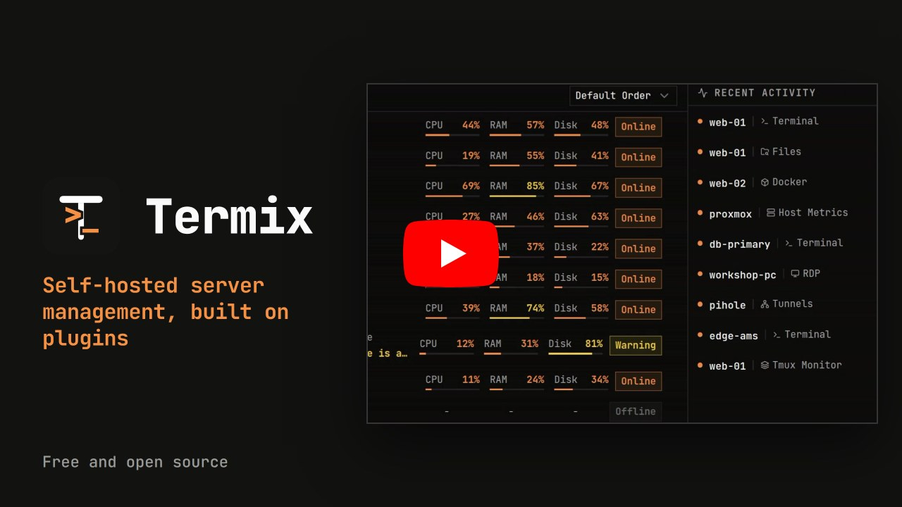

<div align="center">


<h1>Termix</h1>

<p>Self-hosted, plugin-based server management</p>

<p>
  
  
  
  <a href="https://discord.gg/jVQGdvHDrf"></a>
  <a href="https://donate.termix.site/"></a>
</p>

<p>
  <a href="https://donate.termix.site/"></a>
</p>

<a href="https://www.youtube.com/watch?v=vhtkP-UqV5U"></a>

</div>

<br />

## Overview

Termix is a free, open source, self-hosted server management platform built on plugins. The core keeps your hosts, credentials, users, sharing and sessions. Everything else, like the SSH terminal, remote desktop, file manager, Docker and metrics, is a plugin you can turn on, off or remove.

It runs on web, desktop and mobile. Think of it as a free, self-hosted Termius.

<br />

## Try the Demo

Try it at [demo.termix.site](https://demo.termix.site/). Any username and password works.

<br />

## Core

What every install has, with or without plugins:

- Hosts: Save hosts in nested folders with tags and parent hosts, bulk edit, import and export, and use Quick Connect for one-off connections
- Credentials: Reuse saved passwords and keys across hosts, with host defaults you can set for the server, a user or a folder
- Sharing and Roles: Share hosts, credentials and folders with users or roles at four levels: connect, view, edit and manage
- Accounts: Local accounts, sessions you can see and revoke, trusted devices, API keys and an audit log
- Security: Passwords, keys and other secrets are encrypted per user, and the database can be encrypted on disk
- Desktop Sync: The desktop app runs on its own and can link to a Termix server to keep an offline copy of your account
- Interface: Tabs and split screen, a command palette (double tap left shift), rebindable shortcuts, themes, branding and around 30 languages
- Databases: SQLite by default, with PostgreSQL and MySQL supported too

<br />

## Plugins

Plugins add everything else. The official ones ship with Termix, and admins can install, update or remove plugins from the Plugins tab. Each plugin has its own repo.

| Plugin                                                                      | What it does                                                                                                                    |
| --------------------------------------------------------------------------- | ------------------------------------------------------------------------------------------------------------------------------- |
| [ACME Certificates](https://github.com/Termix-SSH/Plugin-ACME-SSL)          | Gets the Termix HTTPS certificate from Let's Encrypt or any ACME provider and renews it for you.                                |
| [AI Assistant](https://github.com/Termix-SSH/Plugin-AI)                     | An AI assistant that reads your setup and proposes changes for you to approve.                                                  |
| [Alerts](https://github.com/Termix-SSH/Plugin-Alerts)                       | One inbox for every alert in Termix, with delivery to webhooks, ntfy, Discord and email.                                        |
| [Ansible](https://github.com/Termix-SSH/Plugin-Ansible)                     | Run Ansible playbooks and ad-hoc commands from a control host, with an inventory made from your Termix hosts.                   |
| [Audit Tools](https://github.com/Termix-SSH/Plugin-Audit-Tools)             | Send the audit log to your SIEM and export it as CSV or NDJSON.                                                                 |
| [Automations](https://github.com/Termix-SSH/Plugin-Automations)             | Run steps on your hosts on a schedule or when something happens.                                                                |
| [Backups](https://github.com/Termix-SSH/Plugin-Backups)                     | Back up folders, databases and Docker data on your hosts with restic, then browse, download and restore.                        |
| [Certificates](https://github.com/Termix-SSH/Plugin-Certificates)           | See, issue and renew TLS certificates on your hosts with certbot and acme.sh, and get an alert before they expire.              |
| [Classic Layout](https://github.com/Termix-SSH/Plugin-Classic-Layout)       | The classic Termix layout with an icon rail, sidebar, tab bar and dock.                                                         |
| [Classic Themes](https://github.com/Termix-SSH/Plugin-Classic-Themes)       | Light, dark and seven more color themes for Termix.                                                                             |
| [Cloud Providers](https://github.com/Termix-SSH/Plugin-Cloud-Providers)     | Add hosts from AWS, Azure, Google Cloud, DigitalOcean, Hetzner and other clouds, and keep them in sync.                         |
| [Credential Tools](https://github.com/Termix-SSH/Plugin-Credential-Tools)   | Generate SSH keys, check them and copy a public key to a host.                                                                  |
| [Cron](https://github.com/Termix-SSH/Plugin-Cron)                           | See, add and run cron jobs on your hosts, with a schedule preview and the system cron files.                                    |
| [Databases](https://github.com/Termix-SSH/Plugin-Databases)                 | Browse and edit MySQL, MariaDB, PostgreSQL and SQLite databases on your hosts from one tab.                                     |
| [DNS](https://github.com/Termix-SSH/Plugin-DNS)                             | Manage DNS records and domains across Cloudflare, Route 53, Namecheap and other providers.                                      |
| [Docker](https://github.com/Termix-SSH/Plugin-Docker)                       | Manage Docker and Podman containers on your hosts over SSH, with logs, stats and a console.                                     |
| [File Manager](https://github.com/Termix-SSH/Plugin-File-Manager)           | Browse, edit and move files over SFTP, including straight from one server to another.                                           |
| [Firewall](https://github.com/Termix-SSH/Plugin-Firewall)                   | Manage UFW, firewalld, nftables and iptables rules on your hosts over SSH, with lockout protection.                             |
| [Fleets](https://github.com/Termix-SSH/Plugin-Fleets)                       | Group hosts into fleets and run commands, package actions and file transfers on all of them at once.                            |
| [Git](https://github.com/Termix-SSH/Plugin-Git)                             | See, pull, commit and push git repos on your hosts, and keep them up to date with auto pull.                                    |
| [Homepage](https://github.com/Termix-SSH/Plugin-Homepage)                   | A drag and drop widget page for your servers and services, plus service links for the dashboard.                                |
| [Host Metrics](https://github.com/Termix-SSH/Plugin-Host-Metrics)           | Live CPU, memory, disk, network and GPU stats, plus tools to manage your hosts.                                                 |
| [Host Status](https://github.com/Termix-SSH/Plugin-Host-Status)             | Shows if each host is online with a dot in the host list, checked by connecting to its port.                                    |
| [Hosts Config](https://github.com/Termix-SSH/Plugin-Hosts-Config)           | Keep hosts, folders and sharing in a YAML or JSON file. Termix loads them as read only hosts and reloads when the file changes. |
| [Import and Export](https://github.com/Termix-SSH/Plugin-Import-Export)     | Import hosts from a JSON file or an SSH config file and export them to share or back up.                                        |
| [IP-KVM](https://github.com/Termix-SSH/Plugin-IP-KVM)                       | See and control machines through PiKVM, NanoKVM and JetKVM devices.                                                             |
| [Kubernetes](https://github.com/Termix-SSH/Plugin-Kubernetes)               | Manage Kubernetes clusters from your hosts over SSH, with logs, metrics, YAML and a shell.                                      |
| [LDAP](https://github.com/Termix-SSH/Plugin-LDAP)                           | Sign in with your LDAP or Active Directory username and password.                                                               |
| [Log Search](https://github.com/Termix-SSH/Plugin-Log-Search)               | Search logs from the journal, log files and Docker containers across many hosts at once.                                        |
| [Login Security](https://github.com/Termix-SSH/Plugin-Login-Security)       | Sign people out when idle, limit session length, turn off remember me and require a second factor at login.                     |
| [Network Devices](https://github.com/Termix-SSH/Plugin-Network-Devices)     | See and manage routers, switches and access points over SNMP and router APIs.                                                   |
| [Network Topology](https://github.com/Termix-SSH/Plugin-Network-Topology)   | Draws your hosts and the links between them as a live, interactive graph.                                                       |
| [Notes](https://github.com/Termix-SSH/Plugin-Notes)                         | Write markdown notes for each host, folder or yourself, with commands you can copy or send to the terminal.                     |
| [Object Storage](https://github.com/Termix-SSH/Plugin-Object-Storage)       | Browse and manage S3-compatible object storage buckets and files.                                                               |
| [Operations Center](https://github.com/Termix-SSH/Plugin-Operations-Center) | Run, roll out, approve and track every plugin action across your hosts, with a page per host and tables across all of them.     |
| [OPKSSH](https://github.com/Termix-SSH/Plugin-OPKSSH)                       | Connect to hosts with short-lived OpenPubkey SSH certificates after signing in with your identity provider.                     |
| [Out-of-band](https://github.com/Termix-SSH/Plugin-Out-Of-Band)             | Power, sensors, event logs and consoles for server BMCs over Redfish, IPMI and Intel AMT.                                       |
| [Packages](https://github.com/Termix-SSH/Plugin-Package-Manager)            | See and install updates on your hosts, search, install and remove packages, and read the package history.                       |
| [Passkeys](https://github.com/Termix-SSH/Plugin-WebAuthn)                   | Sign in with a passkey or security key instead of a password.                                                                   |
| [Privileged Access](https://github.com/Termix-SSH/Plugin-Privileged-Access) | Ask for approval before anyone connects to a privileged host, with access that ends on its own and a full audit trail.          |
| [Process Manager](https://github.com/Termix-SSH/Plugin-Process-Manager)     | See and control running processes, pm2 and supervisor apps on your hosts, read their logs and get alerts when they fail.        |
| [Proxmox](https://github.com/Termix-SSH/Plugin-Proxmox)                     | Import Proxmox VE guests as hosts, keep them in sync and watch node stats.                                                      |
| [Remote Desktop](https://github.com/Termix-SSH/Plugin-Remote-Desktop)       | RDP, VNC and Telnet sessions in your browser, with clipboard, file transfer, sharing and recording.                             |
| [Reverse Proxy](https://github.com/Termix-SSH/Plugin-Reverse-Proxy)         | Reverse proxy for TCP, UDP, HTTP and HTTPS with free certificates and Termix login, managed per host.                           |
| [Samba Shares](https://github.com/Termix-SSH/Plugin-Samba)                  | Create and manage Samba (SMB) file shares, users and permissions on your hosts from one tab.                                    |
| [Secret Sources](https://github.com/Termix-SSH/Plugin-Secret-Sources)       | Pull host passwords and keys from 1Password when you connect instead of storing them in Termix.                                 |
| [Security Center](https://github.com/Termix-SSH/Plugin-Security-Center)     | Audit SSH keys, rotate them and scan hosts for known vulnerabilities over SSH.                                                  |
| [Serial](https://github.com/Termix-SSH/Plugin-Serial)                       | Open a serial console to a router, switch or other device plugged into your computer.                                           |
| [Services](https://github.com/Termix-SSH/Plugin-Service-Manager)            | Manage services, timers and logs on your hosts over SSH.                                                                        |
| [Session Recording](https://github.com/Termix-SSH/Plugin-Session-Recording) | Record terminal and remote desktop sessions and play them back or download them later.                                          |
| [Session Sharing](https://github.com/Termix-SSH/Plugin-Session-Sharing)     | Share live sessions by link or with another user, and present sessions to a group in meeting rooms.                             |
| [Simple Layout](https://github.com/Termix-SSH/Plugin-Simple-Layout)         | A simple Termix layout for small setups with a top bar, a Home screen and only the basics.                                      |
| [Single sign-on](https://github.com/Termix-SSH/Plugin-SSO)                  | Sign in with any OpenID Connect provider, GitHub or Google.                                                                     |
| [Snippets](https://github.com/Termix-SSH/Plugin-Snippets)                   | Save the commands you run often and run them in a terminal or on many hosts in one click.                                       |
| [SSH Certificate Signer](https://github.com/Termix-SSH/Plugin-Vault)        | Connect to hosts with short-lived SSH certificates signed by HashiCorp Vault or OpenBao.                                        |
| [SSH Terminal](https://github.com/Termix-SSH/Plugin-SSH-Terminal)           | SSH terminal sessions with tabs, split screen, history, macros and a local terminal in the desktop app.                         |
| [Step CA](https://github.com/Termix-SSH/Plugin-Step-CA)                     | Connect to hosts with short-lived SSH certificates from a smallstep step-ca server.                                             |
| [Storage Health](https://github.com/Termix-SSH/Plugin-Storage-Health)       | Watch drive and array health over SSH: SMART, NVMe, ZFS, mdadm, btrfs and LVM, with history, alerts and self tests.             |
| [Sync](https://github.com/Termix-SSH/Plugin-Sync)                           | Sync the desktop app with one or more servers, and manage other Termix servers as remote sites from a master.                   |
| [Tailscale](https://github.com/Termix-SSH/Plugin-Tailscale)                 | Add tailnet devices as hosts and connect with Tailscale SSH.                                                                    |
| [Termix Identity](https://github.com/Termix-SSH/Plugin-Termix-Identity)     | Publish your SSH public keys under a public handle and run your own SSH certificate authority.                                  |
| [Tmux Monitor](https://github.com/Termix-SSH/Plugin-Tmux-Monitor)           | Browse and control tmux sessions, windows and panes across your hosts.                                                          |
| [TOTP](https://github.com/Termix-SSH/Plugin-TOTP)                           | Two-factor sign in with a code from an authenticator app, with backup codes.                                                    |
| [Tunnels](https://github.com/Termix-SSH/Plugin-Tunnels)                     | SSH port forwarding that reconnects on its own, plus client tunnels from the desktop app.                                       |
| [UPS Manager](https://github.com/Termix-SSH/Plugin-UPS-Manager)             | Watch your UPS devices over NUT, apcupsd or SNMP, with history, alerts and self tests.                                          |
| [Uptime](https://github.com/Termix-SSH/Plugin-Uptime)                       | Watch websites, ports, hosts and services, get alerts when they go down, and publish status pages.                              |
| [Usage Statistics](https://github.com/Termix-SSH/Plugin-Telemetry)          | Sends a small anonymous daily report so we can see how Termix is used.                                                          |
| [Users](https://github.com/Termix-SSH/Plugin-User-Manager)                  | Manage the user accounts, groups, passwords and SSH keys on your hosts.                                                         |
| [Virtual Machines](https://github.com/Termix-SSH/Plugin-Virtual-Machines)   | Create and manage KVM virtual machines on your Linux hosts over SSH with libvirt.                                               |
| [Wake-on-LAN](https://github.com/Termix-SSH/Plugin-Wake-On-LAN)             | Wake, shut down and track your machines from one power dashboard.                                                               |
| [Warpgate](https://github.com/Termix-SSH/Plugin-Warpgate)                   | Connect to hosts through a Warpgate SSH bastion.                                                                                |
| [Web Endpoint](https://github.com/Termix-SSH/Plugin-Web-Endpoint)           | Open a host's web UI inside Termix, directly or over an SSH tunnel.                                                             |
| [Web Servers](https://github.com/Termix-SSH/Plugin-Web-Servers)             | Manage nginx, Apache and Caddy on your hosts: sites, config, logs and HTTPS, with every change tested first.                    |
| [WireGuard](https://github.com/Termix-SSH/Plugin-WireGuard)                 | Install WireGuard on your hosts and manage interfaces, clients and configs from one tab.                                        |
| [Workspaces](https://github.com/Termix-SSH/Plugin-Workspaces)               | Save your open tabs and split layouts and reopen them in one click.                                                             |

Want to build your own? Start from the [plugin template](https://github.com/Termix-SSH/Termix-Plugin-Template). Plugins you can install are listed in the [registry](https://github.com/Termix-SSH/Termix-Registry). Turn on the community registry in Plugins, Registries to install plugins made by other people, or add your own registry. See [submitting a plugin](https://docs.termix.site/develop/community-registry) and [hosting your own registry](https://docs.termix.site/develop/registries#host-your-own-registry).

<br />

## Platform Support

<table align="center">
<tr>
<th align="center">Platform</th>
<th align="center">Distribution</th>
</tr>
<tr>
<td align="center"><b>Web</b></td>
<td>Any modern browser (Chrome, Safari, Firefox) | PWA support</td>
</tr>
<tr>
<td align="center"><b>Windows</b> <sub>x64/ia32</sub></td>
<td>Portable | EXE and MSI Installer | Full EXE (all plugins) | Chocolatey</td>
</tr>
<tr>
<td align="center"><b>Linux</b> <sub>x64/arm64/armv7l</sub></td>
<td>Portable | AUR | AppImage | Deb | Full AppImage and Deb (all plugins) | Flatpak</td>
</tr>
<tr>
<td align="center"><b>macOS</b> <sub>Universal/x64/arm64, v12.0+</sub></td>
<td>Apple App Store | DMG | Full DMG (all plugins) | Homebrew</td>
</tr>
<tr>
<td align="center"><b>iOS/iPadOS</b> <sub>v15.1+</sub></td>
<td>Apple App Store | IPA</td>
</tr>
<tr>
<td align="center"><b>Android</b> <sub>v7.0+</sub></td>
<td>Google Play Store | APK</td>
</tr>
</table>

<br />

## Installation

See the [docs](https://docs.termix.site/install) for install steps on every platform.

On macOS, choose **Termix → Menu Bar Icon** to use a monochrome icon (the default), a color icon, or hide it. The choice is saved on this device. You can restore a hidden icon from the same menu after opening Termix from the Dock; closing the last window while the icon is hidden quits the app.

Sample Docker Compose file. Remote desktop (RDP, VNC and Telnet) is built in, so nothing else needs to run next to it:

```yaml
services:
  termix:
    image: ghcr.io/termix-ssh/termix:latest
    container_name: termix
    restart: unless-stopped
    ports:
      - "8080:8080"
    volumes:
      - termix-data:/app/data
    environment:
      PORT: "8080"

volumes:
  termix-data:
    driver: local
```

### Cloud Hosting

If Termix runs on the network it manages, an outage takes it down right when you need it. A VPS keeps it reachable, gives you a static IP and works from anywhere without a VPN or port forward.

[GINERNET](https://docs.termix.site/install/ginernet) sponsors Termix and the docs have a setup guide for their VPS.

<br />

## Donate

Termix has no paid plans. Donations cover servers, domains and development time.

[Donate](https://donate.termix.site/)

<br />

## Sponsors

For a paid sponsor spot, email [mail@termix.site](mailto:mail@termix.site).

<!-- SPONSORS:START -->

<div align="center">

<br />

<a href="https://www.blacksmith.sh/">
  
</a>
&nbsp;&nbsp;&nbsp;
<a href="https://www.cloudflare.com/">
  
</a>
&nbsp;&nbsp;&nbsp;
<a href="https://akamai.com/">
  
</a>
&nbsp;&nbsp;&nbsp;
<a href="https://aws.amazon.com/">
  
</a>
&nbsp;&nbsp;&nbsp;
<a href="https://rackgenius.com/">
  
</a>
&nbsp;&nbsp;&nbsp;
<a href="https://ginernet.com/">
  
</a>
&nbsp;&nbsp;&nbsp;
<a href="https://www.hetzner.com/?mtm_campaign=termix&mtm_medium=referral&mtm_content=sponsoring_link">
  
</a>

</div>

<!-- SPONSORS:END -->

<br />

## Support

Bugs and ideas for Termix itself (login, hosts, credentials, sharing, sync, the app and desktop app) go in this repo: [report a bug](https://github.com/Termix-SSH/Termix/issues/new?template=bug_report.yml) or [request a feature](https://github.com/Termix-SSH/Termix/issues/new?template=feature_request.yml).

Every plugin has its own repo, so a problem with the terminal, file manager, Docker, remote desktop or any other plugin goes in that plugin's repo (see the table above, or use Report an issue on the plugin's page in the app, which fills in your versions for you). Not sure where it goes? Open it here and it will be moved.

You need a GitHub account. Add as much detail as you can, in English if possible.

For discussions and questions, join the [Discord](https://discord.gg/jVQGdvHDrf) server. Update videos are on [YouTube](https://www.youtube.com/@TermixSSH/videos).

<br />

## License

Apache License 2.0. See [LICENSE](LICENSE).
